# Post-contenido — Unidad 11: Buenas Prácticas y Patrones de Diseño

## Información del Estudiante
* **Nombre:** Andrea Valentina Rivera Fernández
* **Código:** 1152444
* **Institución:** Universidad Francisco de Paula Santander (UFPS)
* **Carrera:** Ingeniería de Sistemas
* **Materia:** Programación Web
* **Unidad:** 11
* **Año:** 2026

## Descripción

Repositorio del laboratorio de la Unidad 11 de Programación Web — Séptimo
Semestre. Contiene un único proyecto Maven Spring Boot (`pedidos/`, paquete
`com.tienda.pedidos`) con un sistema de gestión de pedidos de una tienda en
línea. El proyecto **parte de un código funcional pero mal diseñado**, con
violaciones reales de SOLID (SRP y DIP), SQL concatenado en el controller y la
entidad JPA expuesta directamente en la API (primer commit del historial).

- **Parte 1:** se refactoriza con arquitectura en capas, el patrón DTO,
  inyección de dependencias por constructor y el patrón **Strategy** para el
  descuento según el tipo de cliente.
- **Parte 2:** se endurece con manejo centralizado de errores
  (`@RestControllerAdvice`), logging con SLF4J/Logback y documentación con
  springdoc-openapi/Swagger.

**Estudiante:** Andrea Valentina Rivera Fernández

## Tecnologías

Java 17, Spring Boot 4.x (Web, Data JPA, Validation), H2 en memoria,
SLF4J + Logback, springdoc-openapi 3.0.0 (Swagger UI), Maven (`mvnw`) e
IntelliJ IDEA.

> **Nota sobre versiones:** el enunciado está escrito para Spring Boot 3.2 y
> springdoc 2.3.0. Este proyecto usa Spring Boot 4, por lo que se empleó la
> serie 3.0.x de springdoc (la 2.x es para Boot 3 y no arranca en Boot 4). Se
> omitió `spring.h2.console.enabled`, que en Boot 4 requiere otra dependencia y
> no se usa en este laboratorio.

## Violaciones del código de partida y cómo se corrigió cada una

| # | Violación en el código de partida | Corrección |
|---|---|---|
| 1 | **SRP**: `crearPedido` validaba, calculaba el descuento, armaba el SQL, persistía, notificaba y registraba el log (seis responsabilidades en un solo método). | El controller solo traduce HTTP ↔ DTO. La validación pasa a Bean Validation en `PedidoRequestDTO`, el cálculo a las estrategias, la orquestación a `PedidoServiceImpl`, la persistencia a `PedidoRepository`, la notificación a `NotificacionService` y el log a SLF4J. |
| 2 | **DIP**: `new NotificacionEmailService()` dentro del controller. | `NotificacionService` (interfaz) + `NotificacionEmailServiceImpl` (`@Service`) inyectada por constructor. El controller depende de la interfaz `PedidoService`. No queda ningún `new` de un colaborador. |
| 3 | **Sin capa de acceso a datos**: SQL concatenado con `JdbcTemplate` en el controller (riesgo de inyección SQL). | `PedidoRepository extends JpaRepository<Pedido, Long>` con la consulta derivada `findByClienteEmail`. No queda ninguna sentencia SQL escrita a mano. |
| 4 | **Entidad expuesta**: se devolvía `Pedido` completo, incluido `notasInternas`. | `PedidoRequestDTO` (entrada, con `@NotBlank`, `@NotNull` y `@Positive`) y `PedidoResponseDTO` (salida, **sin** `notasInternas`), con mapeo explícito en `toResponseDTO()`. |
| 5 | **Lógica condicional rígida (OCP)**: `if / else if / else` por tipo de cliente. | Patrón Strategy: `EstrategiaDescuento` + `DescuentoRegular`, `DescuentoVip` y `DescuentoMayorista`, inyectadas como `Map<String, EstrategiaDescuento>`. |
| 6 | **Errores silenciados**: `try/catch` con `println` que devolvía `null` (200 OK vacío para un id inexistente). | `RecursoNoEncontradoException` + `GlobalExceptionHandler`, que responde `404` con `ApiError`. |
| 7 | **Validación manual** con `RuntimeException` (respondía 500 por errores del cliente). | Bean Validation en el DTO; `GlobalExceptionHandler` responde `400` con los mensajes de cada campo. |
| 8 | **`System.out.println`** como log. | SLF4J con placeholders `{}` y niveles DEBUG/INFO/WARN/ERROR; `logback-spring.xml` con consola y archivo rotativo. |

### Evidencia del código de partida (antes de refactorizar)

**El POST del código de partida devuelve `notasInternas` al cliente (fuga de datos)**
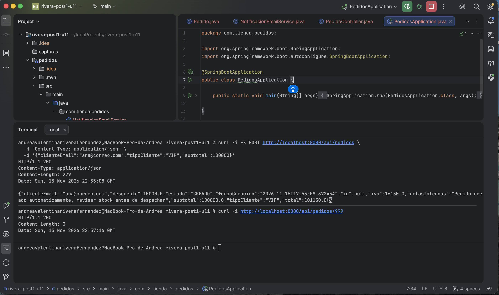

## Arquitectura resultante (diagrama de clases en texto)

```
                 HTTP (JSON)
                     │
┌────────────────────▼─────────────────────┐     ┌─────────────────────────────────┐
│ controller.PedidoController              │     │ exception.GlobalExceptionHandler│
│  + crear(PedidoRequestDTO): ResponseDTO  │────►│  @RestControllerAdvice          │
│  + obtener(Long): PedidoResponseDTO      │     │  404 / 400 / 500 → ApiError     │
└────────────────────┬─────────────────────┘     └─────────────────────────────────┘
                     │ depende de la interfaz (DIP)
┌────────────────────▼─────────────────────┐
│ «interface» service.PedidoService        │
│  + crear(PedidoRequestDTO)               │
│  + buscarPorId(Long)                     │
└────────────────────▲─────────────────────┘
                     │ implementa
┌────────────────────┴─────────────────────┐  usa  ┌──────────────────────────────────┐
│ service.PedidoServiceImpl                │──────►│ «interface» strategy.            │
│  - repo: PedidoRepository                │       │   EstrategiaDescuento            │
│  - notificador: NotificacionService      │       │  + calcularDescuento(double)     │
│  - estrategias: Map<String,Estrategia..> │       └───────▲───────────▲───────────▲──┘
│  - toResponseDTO(Pedido)                 │     DescuentoRegular DescuentoVip DescuentoMayorista
└───────┬───────────────────────┬──────────┘     @Component       @Component  @Component
        │                       │                ("REGULAR")       ("VIP")     ("MAYORISTA")
┌───────▼──────────────┐  ┌─────▼───────────────────────────┐
│ «interface»          │  │ «interface» NotificacionService │
│ repository.          │  │  + enviarConfirmacion(...)      │
│ PedidoRepository     │  └─────▲───────────────────────────┘
│ extends JpaRepository│        │ implementa
└───────┬──────────────┘  NotificacionEmailServiceImpl (@Service)
        │ persiste
┌───────▼───────────────┐   dto.PedidoRequestDTO  (entrada, Bean Validation, @Schema)
│ entity.Pedido (@Entity)│  dto.PedidoResponseDTO (salida, sin notasInternas)
└────────────────────────┘
```

Paquetes: `controller`, `service`, `repository`, `dto`, `entity`, `strategy`,
`exception`.

## Parte 1 — Refactorización con SOLID, DTO y Strategy

### Checkpoint 1 — DTO y DAO (`PedidoRepository`)

Se crearon `PedidoRequestDTO` (entrada, con validaciones) y
`PedidoResponseDTO` (salida, sin `notasInternas`), y se reemplazó el
`JdbcTemplate` por `PedidoRepository extends JpaRepository`. El SQL embebido
desaparece por completo.

**Compilación exitosa (`./mvnw compile` termina en `BUILD SUCCESS`)**
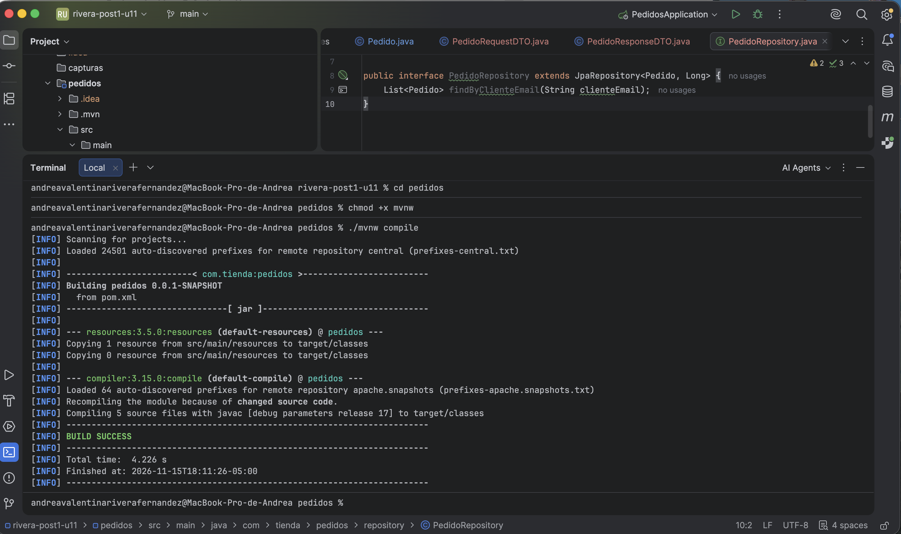

**`PedidoResponseDTO` sin `notasInternas` y los paquetes `dto` y `repository`**
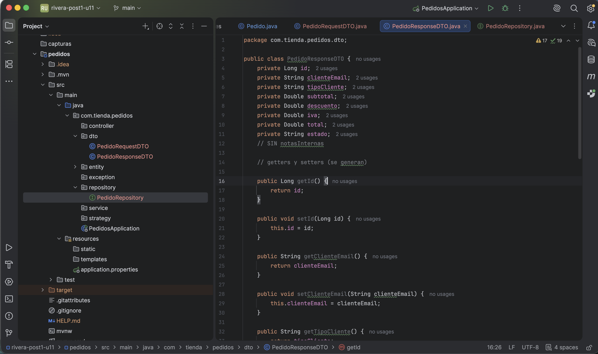

### Checkpoint 2 — `PedidoService` con DIP

`PedidoServiceImpl` implementa la interfaz `PedidoService` y recibe por
constructor el `PedidoRepository`, el `NotificacionService` (interfaz, ya no
instanciada con `new`) y el `Map` de estrategias. El controller solo delega en
el servicio.

**Constructor de `PedidoServiceImpl` y paquetes del proyecto**
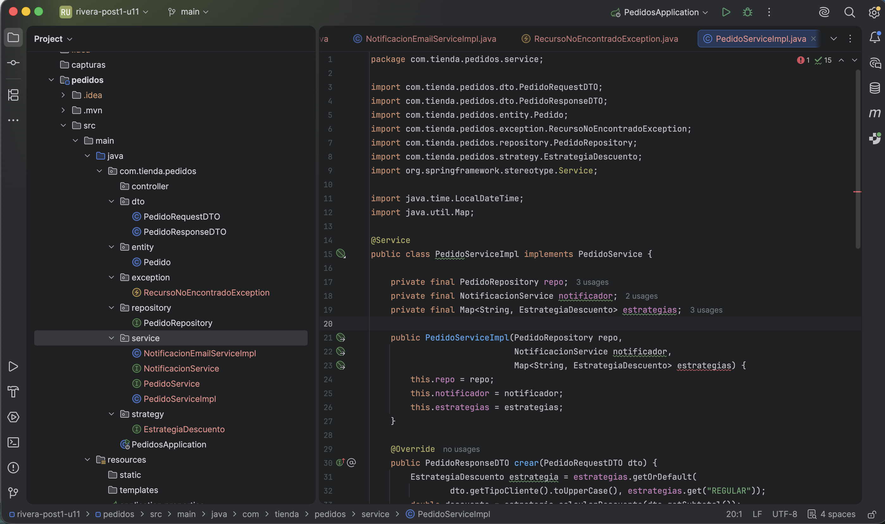

### Checkpoint 3 — Strategy para el descuento

El `if / else if` del controller pasó a tres clases registradas como beans con
nombre (`REGULAR`, `VIP`, `MAYORISTA`). Spring inyecta un
`Map<String, EstrategiaDescuento>` cuya llave es el nombre del bean, y el
servicio elige la estrategia con `getOrDefault(tipoCliente.toUpperCase(), ...)`.

Con `subtotal = 100000`:

| tipoCliente | descuento | iva (19 % de subtotal − descuento) | total |
|---|---|---|---|
| VIP        | 15000 | 16150 | 101150 |
| MAYORISTA  | 25000 | 14250 | 89250  |
| REGULAR    | 0     | 19000 | 119000 |

Un tipo desconocido (por ejemplo `ORO`) usa la estrategia `REGULAR` y deja un
log `WARN`.

**POST cliente VIP: descuento 15000, iva 16150, total 101150, sin `notasInternas`**
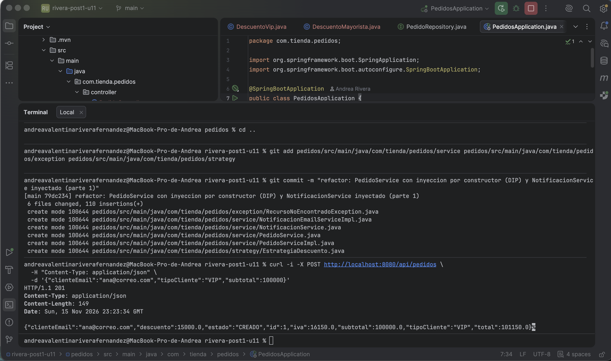

**POST cliente MAYORISTA: descuento 25000**
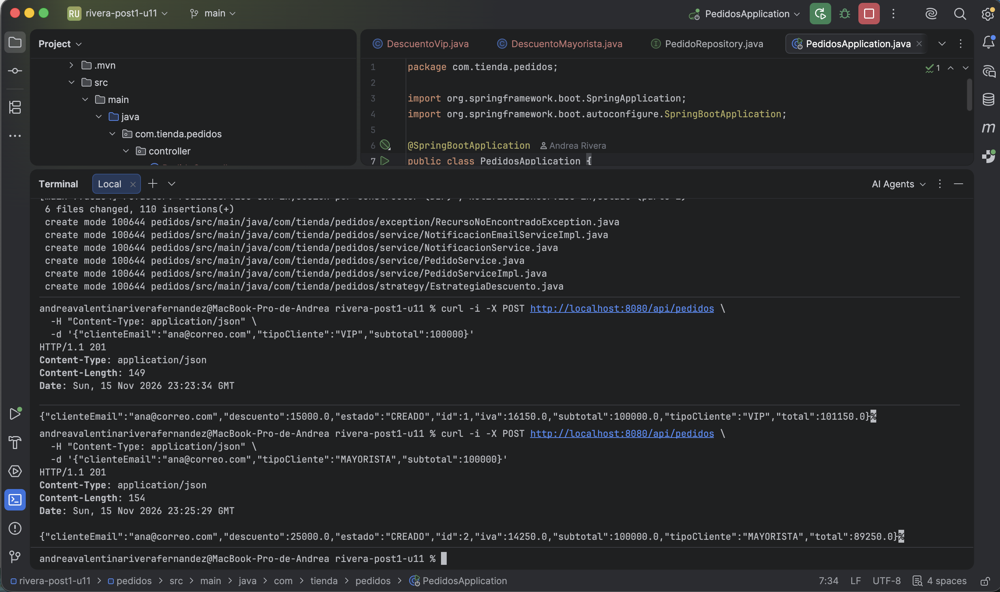

**POST cliente REGULAR: descuento 0**
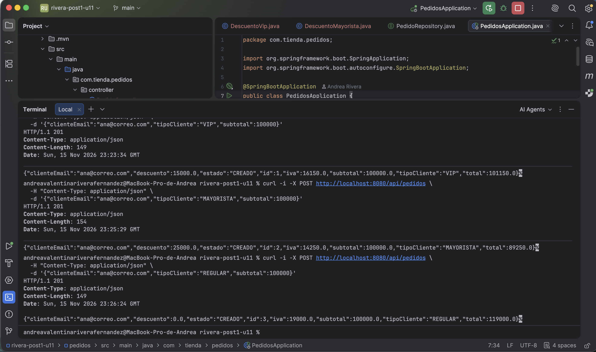

**GET `/api/pedidos/999` al cierre de la Parte 1: error 500 (el handler llega en la Parte 2)**
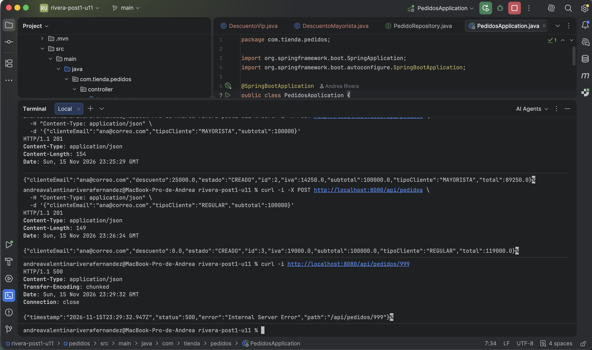

**Historial de commits de la Parte 1**
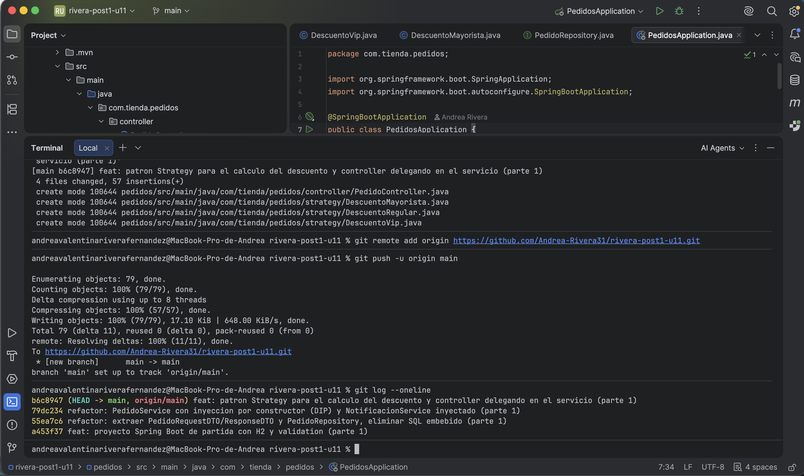

## Parte 2 — Manejo de errores, logging y documentación

### Checkpoint 1 — `GlobalExceptionHandler`

`@RestControllerAdvice` con tres manejadores que devuelven un `ApiError`
(`status`, `error`, `mensaje`, `timestamp`, `path`):

| Excepción | Código | Cuándo ocurre |
|---|---|---|
| `RecursoNoEncontradoException` | 404 | El pedido consultado no existe |
| `MethodArgumentNotValidException` | 400 | El cuerpo no cumple las validaciones del DTO (todos los campos inválidos van en `mensaje`) |
| `Exception` | 500 | Error inesperado: el cliente recibe un mensaje genérico y la traza completa queda en el log `ERROR` |

No queda ningún `try/catch` en el controller.

**GET `/api/pedidos/999`: 404 con `ApiError`**
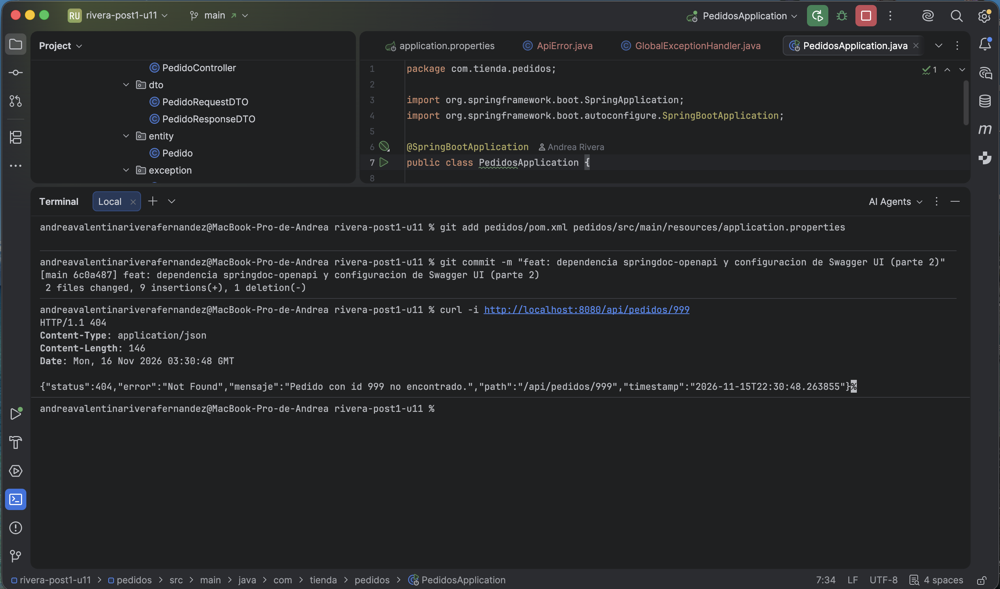

**POST con `{}`: 400 con los errores de validación**
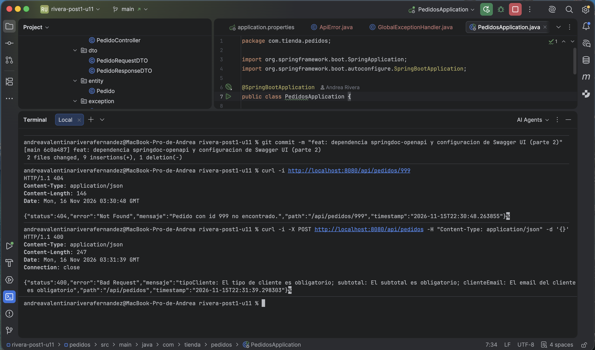

### Checkpoint 2 — SLF4J y Logback

`PedidoServiceImpl` usa un `Logger` de SLF4J con placeholders `{}`:
`INFO` en operaciones exitosas (pedido creado, descuento aplicado,
notificación), `WARN` en situaciones inusuales (pedido no encontrado, tipo de
cliente desconocido), `ERROR` en excepciones no previstas y `DEBUG` en
consultas. `logback-spring.xml` define el appender `CONSOLA` y el
`RollingFileAppender` `ARCHIVO` (`logs/pedidos.log`, rotación diaria
`logs/pedidos.%d{yyyy-MM-dd}.log`, `maxHistory` 30). La carpeta `logs/` está en
`.gitignore` y no queda ningún `System.out.println` en el proyecto.

**Logs en consola con formato SLF4J (INFO del pedido y del descuento, WARN del 999)**
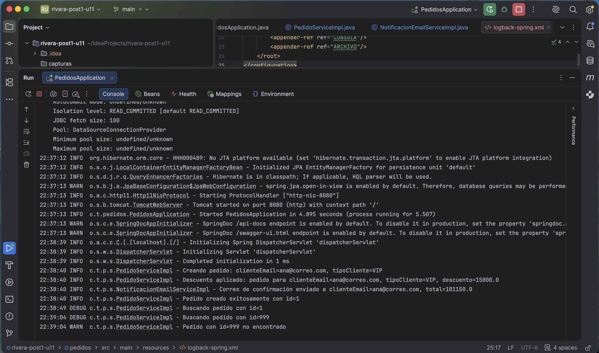

**Archivo `logs/pedidos.log` con fecha completa**
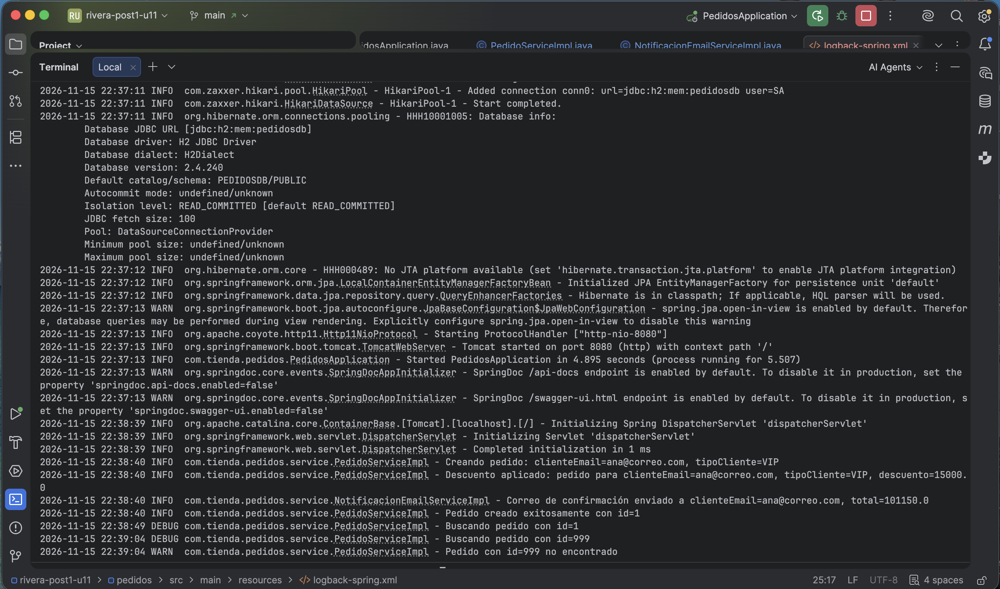

### Checkpoint 3 — Documentación con springdoc-openapi

`@OpenAPIDefinition` en `PedidosApplication`, `@Tag` en el controller,
`@Operation` + `@ApiResponse` (201/200, 400, 404) en los dos endpoints,
`@Parameter` en el `id` y `@Schema` con descripción y ejemplo en
`PedidoRequestDTO`. Todas las descripciones están en español.

| Método | Ruta | Respuestas |
|---|---|---|
| POST | `/api/pedidos` | 201 `PedidoResponseDTO` · 400 `ApiError` |
| GET | `/api/pedidos/{id}` | 200 `PedidoResponseDTO` · 404 `ApiError` |

**Swagger UI con el grupo "Pedidos" y el POST expandido (201 y 400)**
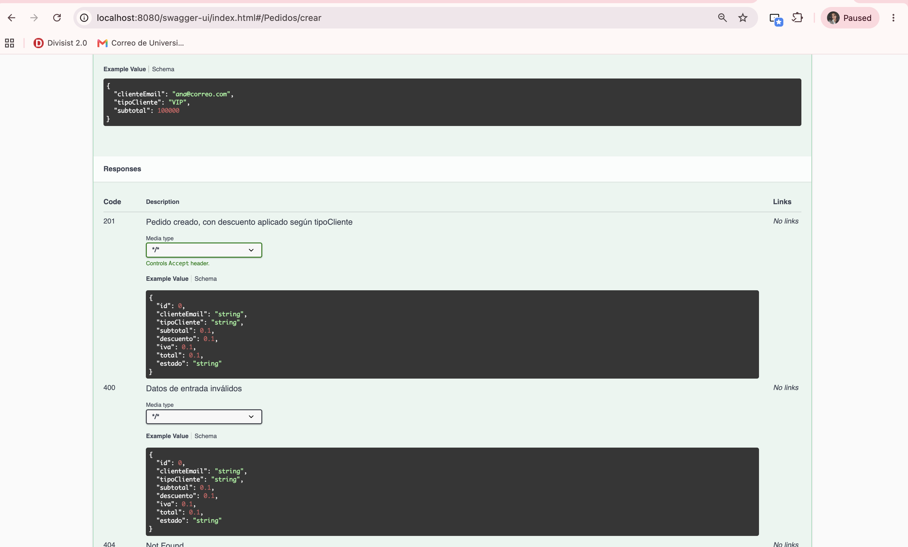

**Swagger UI con el GET expandido (200 y 404)**
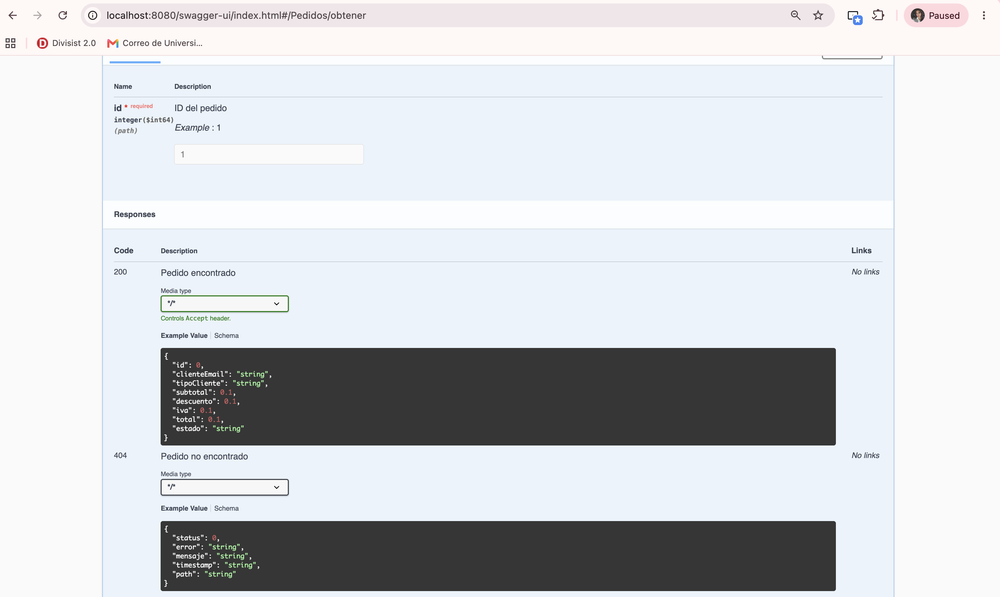

**Historial completo de commits (ambas partes)**
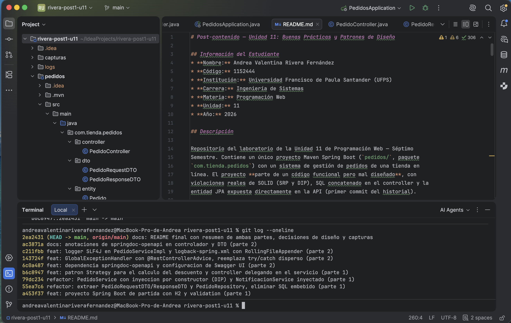

## Decisiones de diseño

### Parte 1

- **`JpaRepository` en vez de mantener `JdbcTemplate`:** el SQL concatenado
  exponía el proyecto a inyección SQL y obligaba a sincronizar las sentencias
  con la entidad a mano. Spring Data genera el CRUD y las consultas derivadas
  como sentencias parametrizadas, con verificación de tipos en compilación.
- **Strategy (y no un segundo patrón creacional para el DTO):** el descuento
  tiene variación real de comportamiento y puede crecer; un tipo
  `CORPORATIVO` futuro solo exige una clase nueva con
  `@Component("CORPORATIVO")`, sin modificar `PedidoServiceImpl` (OCP). La
  conversión entidad → DTO es un mapeo 1:1 sin condiciones, así que se
  resuelve con el método privado `toResponseDTO()` en lugar de una clase
  Factory/Mapper adicional (se evita la sobre-ingeniería).
- **Estrategias como `Map<String, EstrategiaDescuento>` inyectado:** Spring
  llena el mapa con el nombre de cada bean como llave, así el servicio elige
  la estrategia sin `switch` ni `if` por tipo de cliente.

### Parte 2

- **El registro del descuento aplicado vive en el servicio, no en cada
  Strategy:** un solo mensaje `INFO` justo después de invocar la estrategia
  deja un único punto de auditoría por pedido, en vez de dispersarlo en tres
  clases.
- **`notasInternas` nunca se registra ni se expone:** es información
  operativa de logística; los logs pueden compartirse con soporte y se
  conservan 30 días. Los mensajes solo incluyen identificadores
  (`id`, `clienteEmail`, `tipoCliente`) y montos.
- **El 500 no revela detalles:** el cliente recibe "Error inesperado.
  Contactar soporte." y la traza completa queda en el log `ERROR`.
- **`@NotNull` junto a `@Positive` en `subtotal`:** `@Positive` acepta `null`,
  lo que provocaría un `NullPointerException` en el servicio; con `@NotNull` el
  error se convierte en un 400 claro.

## Cómo compilar y ejecutar

```bash
git clone https://github.com/Andrea-Rivera31/rivera-post1-u11.git
cd rivera-post1-u11/pedidos
chmod +x mvnw
./mvnw compile             # Checkpoint 1
./mvnw spring-boot:run     # o ejecutar PedidosApplication desde IntelliJ
```

```bash
# POST con cliente VIP → 201 con descuento 15000, iva 16150, total 101150
curl -i -X POST http://localhost:8080/api/pedidos -H "Content-Type: application/json" \
  -d '{"clienteEmail":"ana@correo.com","tipoCliente":"VIP","subtotal":100000}'

# GET inexistente → 404 con ApiError
curl -i http://localhost:8080/api/pedidos/999

# POST vacío → 400 con los errores de validación
curl -i -X POST http://localhost:8080/api/pedidos -H "Content-Type: application/json" -d '{}'
```

Logs: en la consola y en `logs/pedidos.log` (la carpeta se crea relativa al
directorio desde el que se ejecuta la aplicación).
Swagger UI: http://localhost:8080/swagger-ui.html — OpenAPI JSON:
http://localhost:8080/api-docs

La base de datos H2 es en memoria: se reinicia vacía en cada ejecución.

## Historial de commits

| Parte | Mensaje del commit |
|---|---|
| 1 | `feat: proyecto Spring Boot de partida con H2 y validation (parte 1)` |
| 1 | `refactor: extraer PedidoRequestDTO/ResponseDTO y PedidoRepository, eliminar SQL embebido (parte 1)` |
| 1 | `refactor: PedidoService con inyeccion por constructor (DIP) y NotificacionService inyectado (parte 1)` |
| 1 | `feat: patron Strategy para el calculo del descuento y controller delegando en el servicio (parte 1)` |
| 2 | `feat: dependencia springdoc-openapi y configuracion de Swagger UI (parte 2)` |
| 2 | `feat: GlobalExceptionHandler con @RestControllerAdvice, reemplaza try/catch disperso (parte 2)` |
| 2 | `feat: logger SLF4J en PedidoServiceImpl y logback-spring.xml con RollingFileAppender (parte 2)` |
| 2 | `docs: anotaciones de springdoc-openapi en controlador y DTO (parte 2)` |
| 2 | `docs: README final con resumen de ambas partes, decisiones de diseño y capturas` |